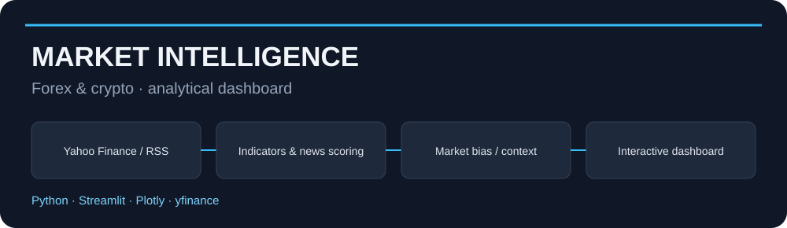

<div align="center">

# MARKET INTELLIGENCE



**Forex & crypto · analytical dashboard**

Python · Streamlit · Plotly · yfinance

</div>

## Overview

A Streamlit dashboard combining historical market prices, technical indicators and headline context in one interface.

## Capabilities
- Forex pair and cryptocurrency selection with configurable historical periods.
- Candlestick visualization with SMA20 and SMA50 overlays.
- RSI (14), daily changes and moving-average gap metrics.
- RSS headlines and a keyword-based macro sentiment heuristic.
- UTC-based trading-session labels and cached data requests.

## Run locally
```bash
python -m venv .venv-local
# Activate the environment, then:
pip install -r requirements.txt
streamlit run App.py
```

## Analytical boundaries
Prices are obtained using daily historical bars, not a guaranteed real-time feed. Market bias and headline scoring are simple heuristics, not validated forecasts. External feeds may change or become unavailable. This project is for analytical exploration, not automated trading.
